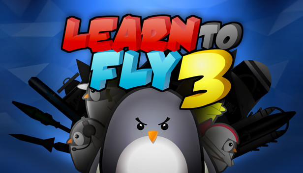

# Learn to Fly 3: source code

ActionScript 3 source for Learn to Fly 3 version 1.2.13 (Steam build 2826715). Most of the code is in separate ActionScript classes. A smaller set of frame scripts inside Flash movie clips handles loading, interface elements, and animation.

This is an edited snapshot of the Flash source. We removed platform integrations and cleaned up the scripts that called them. The gameplay guides point to the retained mechanics and formulas.

## Mechanics

The notes follow a flight from launch through stage and boost use to cash payout. They also cover equipment stats by level, upgrades, and game modes.

1. [Flight and payouts](docs/mechanics.md)
2. [Equipment stats](docs/items.md) and [level curves](docs/item-levels.md)
3. [Upgrades and Bonus Shop](docs/upgrades.md)
4. [Progression and game modes](docs/progression.md)

## Artwork renders

[Preview](docs/art-renders/preview.png) · [Asset manifest](docs/art-renders/manifest.csv). The full pack contains transparent 256 × 256 and 1024 × 1024 PNGs in `learn-to-fly-3-art-renders.zip` for [Releases](../../releases).

## What's here

This release is for reading the source. The original art files, sound, Flash project file and third-party libraries aren't included.

1. `src/`: the game's classes. Most of the flight is in `src/game`, and item, upgrade and stat definitions are in `src/reg/Registry.as`.
2. `scripts/`: the code that sat on timeline frames inside the Flash project file, one file per timeline. Each block starts with a comment saying which layer and frame it's on.
3. `framework/lbg/`: Light Bringer Games' shared Flash utilities.

Not included, since they aren't ours to relicense: Nape (physics), FRESteamWorks, as3corelib, as3crypto, and the other third-party Flash libraries the framework used.

Several framework files carry their own terms: `CollisionDetection.as` (Grant Skinner, MIT), `Easing.as` (Robert Penner, BSD), `BigInt.as` (Leemon Baird, ActionScript port by Ian Peters, public domain), and `MouseWheelTrap.as` (spikything.com, MIT).

## License

The [LBG-NCNC License v1.0](LICENSE.md) covers Light Bringer Games' source code in this repository.

You can read, use, change, and share the code for noncommercial purposes, including by forking it on GitHub. When sharing, credit Light Bringer Games and keep the license and copyright notices. Get written permission before distributing or hosting a product based on the code that competes with or undercuts a Light Bringer Games product or service, even if it's free. The full license governs.

Light Bringer Games reserves its rights in the game's name, art, and sound. Third-party files have their own licenses.
